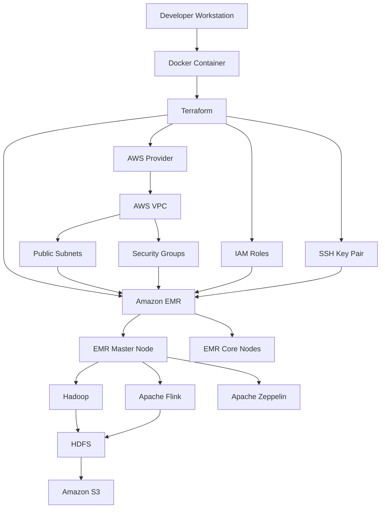

# AWS Infrastructure as Code with Terraform

## Overview

This project uses **Terraform** to provision and manage an AWS environment for distributed data processing with **Amazon EMR**.

The infrastructure includes an AWS VPC, networking components, security groups, IAM roles, an Amazon EMR cluster, and SSH access.

The EMR cluster is configured with Hadoop, Apache Flink, and Zeppelin, providing an environment for distributed data processing and experimentation.

The project also uses Docker to provide a consistent environment with Terraform and the AWS CLI.

## Architecture



## Technologies

- **Infrastructure as Code:** Terraform
- **Cloud Provider:** Amazon Web Services (AWS)
- **Containerization:** Docker
- **Distributed Processing:** Apache Hadoop and Apache Flink
- **Data Storage:** Amazon S3 and HDFS
- **Data Exploration:** Apache Zeppelin
- **Cloud Infrastructure:** Amazon EMR, VPC, EC2, IAM
- **Command Line:** AWS CLI

## Project Structure

```text
Terraform/
├── Dockerfile
├── README.md
├── LEIAME.txt
└── IaC/
    ├── main.tf
    ├── config.tfvars
    ├── emr/
    │   ├── emr.tf
    │   ├── iam.tf
    │   └── security_groups.tf
    ├── job/
    │   └── dados.txt
    ├── network/
    │   ├── constants.tf
    │   └── main.tf
    └── ssh/
        └── main.tf
```

### Infrastructure Components

| Component | Description |
|---|---|
| VPC | Creates the AWS virtual network |
| Network | Configures public subnets and networking resources |
| Security Groups | Controls network access to EMR instances |
| IAM | Creates roles and permissions required by EMR |
| SSH | Generates an SSH key pair and registers the public key in AWS |
| EMR | Provisions the cluster and configures Hadoop, Flink, and Zeppelin |

## Prerequisites

Before starting, make sure you have:

- Docker installed.
- An AWS account.
- AWS credentials with permissions to create the required infrastructure.
- An existing S3 bucket for EMR logs, matching the `log_uri` configuration.
- An AWS region supported by the project configuration.

**Important:** Provisioning AWS resources may generate costs. Review the selected EC2 instance types and EMR configuration before deployment.

## Installation

### 1. Clone the repository

```bash
git clone https://github.com/dlinoba/Terraform.git

cd Terraform
```

### 2. Build the Docker image

```bash
docker build -t dsa-terraform-image:latest .
```

### 3. Configure AWS credentials

Configure your AWS credentials on the host machine:

```bash
aws configure
```

Alternatively, use an existing AWS credentials file.

### 4. Start the container

From the repository root, mount the IaC directory and AWS credentials:

```bash
docker run -it \
  --name dsa-terraform \
  -v "$(pwd)/IaC:/iac" \
  -v "$HOME/.aws:/root/.aws:ro" \
  dsa-terraform-image:latest
```

This example uses a Linux/macOS shell. On Windows, adjust the volume paths according to your Docker environment.

### 5. Verify the installed tools

Inside the container:

```bash
terraform version
aws --version
```

## Configuration

Before provisioning the infrastructure, review:

```text
IaC/config.tfvars
```

Example configuration:

```hcl
region                    = "us-east-2"
project                   = "projeto1"
owner                     = "DSA"
environment               = "EMR"
emr_release_label         = "emr-7.0.0"
emr_main_instance_type    = "m5.xlarge"
emr_core_instance_type    = "m5.xlarge"
emr_core_instance_count   = "2"
```

Adjust the region, project information, EMR release, and instance types according to your requirements.

**S3 Log Bucket**

The EMR configuration requires an S3 bucket for log storage.

Create the bucket in the AWS region configured in the project and update the `log_uri` value in:

```text
IaC/emr/emr.tf
```

Replace the example placeholder with your actual bucket name.

## Terraform Deployment

All Terraform commands must be executed from the `/iac` directory inside the container.

### 1. Initialize Terraform

```bash
cd /iac

terraform init
```

### 2. Validate the configuration

```bash
terraform validate
```

### 3. Format the configuration

```bash
terraform fmt -recursive
```

### 4. Generate an execution plan

```bash
terraform plan \
  -var-file="config.tfvars" \
  -out="terraform.tfplan"
```

Review the proposed changes before applying them.

### 5. Apply the infrastructure

```bash
terraform apply terraform.tfplan
```

Alternatively, run:

```bash
terraform apply -var-file="config.tfvars"
```

Terraform will provision the configured AWS resources.

### 6. Retrieve the EMR master address

```bash
terraform output
```

The project provides the `emr_main_address` output with the EMR master address.

## SSH Access

The project generates an SSH key pair and registers the public key with AWS.

After provisioning, locate the generated private key under:

```text
generated/ssh/deployer
```

Set the appropriate file permissions:

```bash
chmod 400 generated/ssh/deployer
```

Connect to the EMR master node:

```bash
ssh -i generated/ssh/deployer hadoop@<EMR_MASTER_PUBLIC_DNS>
```

Replace `<EMR_MASTER_PUBLIC_DNS>` with the master address returned by Terraform.

**Security note:** Restrict SSH access to trusted IP addresses. Never commit private keys or Terraform State files to Git.

## Running Apache Flink Jobs

After connecting to the EMR master node, you can use HDFS to store and access input data.

### 1. Create an HDFS directory

```bash
hdfs dfs -mkdir -p /user/hadoop/input
```

### 2. Upload input data

```bash
hdfs dfs -put dados.txt /user/hadoop/input/
```

### 3. Check the uploaded files

```bash
hdfs dfs -ls /user/hadoop/input
```

### 4. Submit a Flink job

Once your Flink application JAR is available on the master node:

```bash
flink run -m yarn-cluster /path/to/your-flink-job.jar
```

Replace the JAR path with the actual application location and configure the job's input and output paths as required.

## Infrastructure Cleanup

To avoid unnecessary AWS charges, destroy the infrastructure when it is no longer needed.

From the `/iac` directory:

```bash
terraform destroy -var-file="config.tfvars"
```

Confirm the operation when prompted.

**Important:** Review the resources before destroying them. Back up any data that must be retained, and check separately for resources such as S3 buckets that may not be managed by this Terraform configuration.

## Security Considerations

- Do not commit AWS credentials or private SSH keys.
- Do not commit Terraform State files or execution plans.
- Restrict SSH access to trusted IP addresses.
- Use IAM roles with the minimum permissions required.
- Protect Terraform State with encryption and appropriate access controls.
- Review security groups and network exposure before deployment.
- Keep the Terraform provider and module versions controlled.

## Author

**Deyvid Linoba**

- GitHub: [github.com/dlinoba](https://github.com/dlinoba)
- LinkedIn: [linkedin.com/in/deyvid-linoba](https://www.linkedin.com/in/deyvid-linoba/)